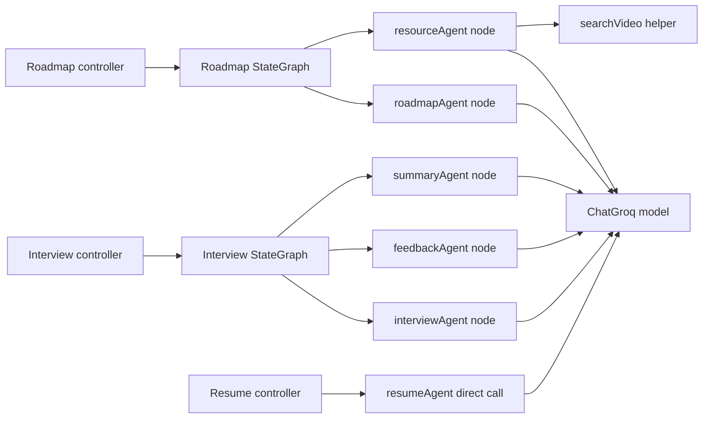
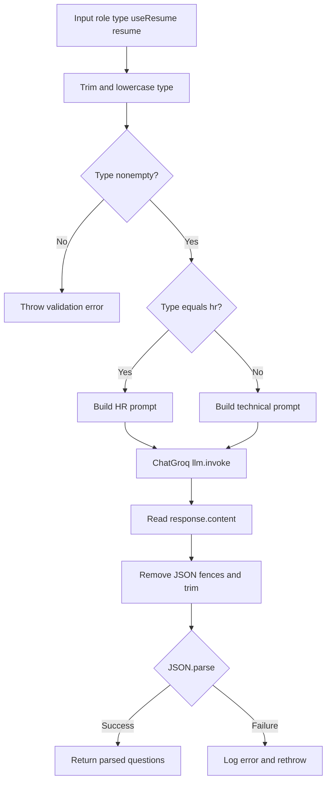
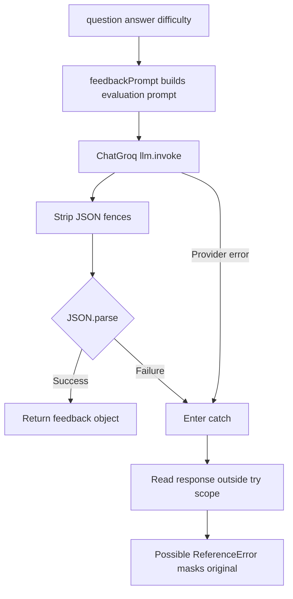
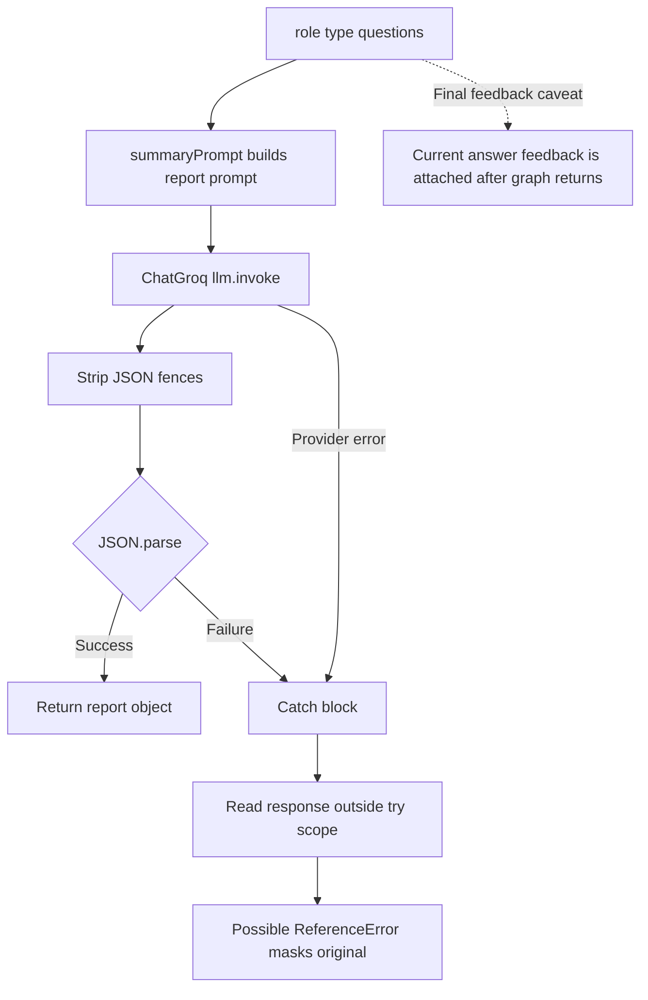
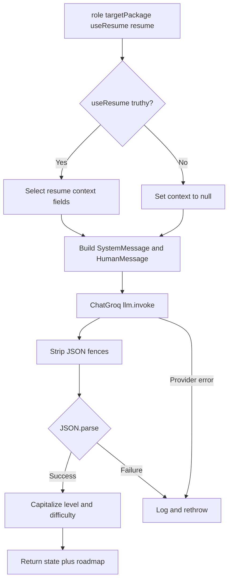
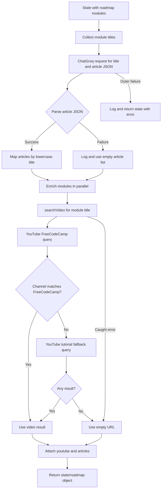
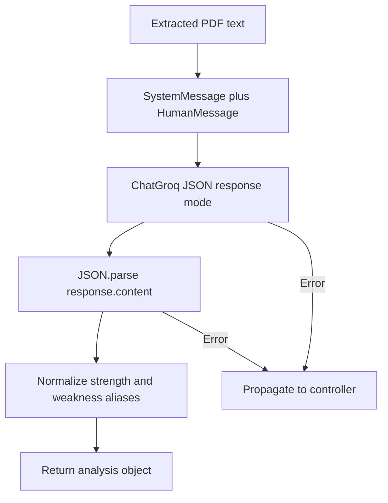
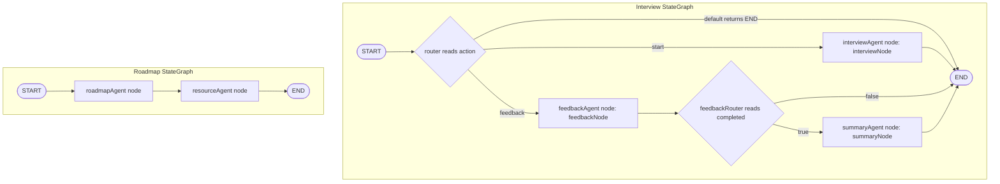
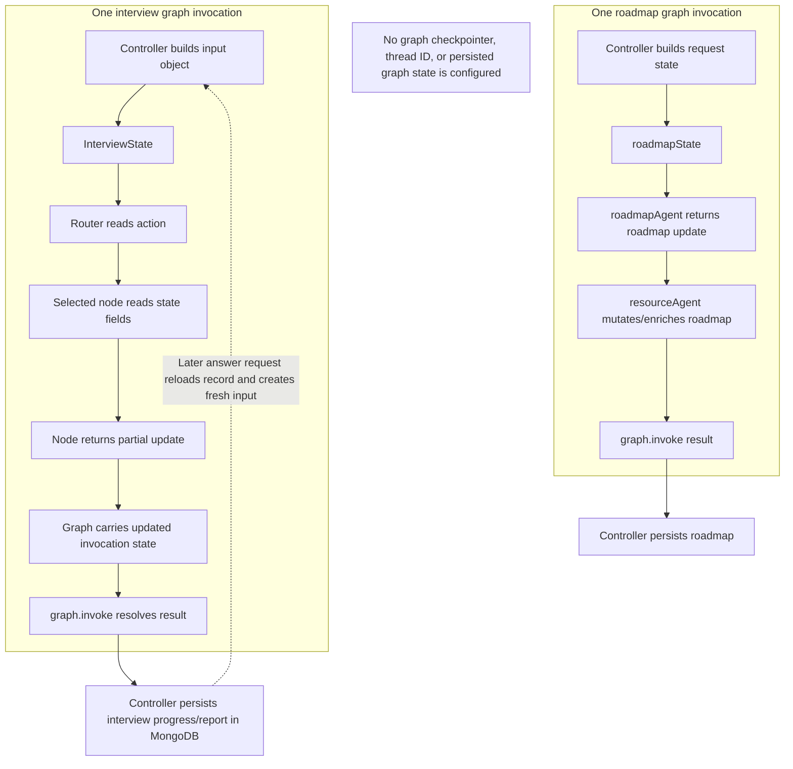

# LangGraph Architecture and Agent Orchestration

This document describes only the LangGraph graphs and model-backed agents implemented in this repository. It is grounded in the graph, agent, prompt, and controller source files. It does not describe AWS, Docker, the frontend, or unrelated backend behavior.

## 1. LangGraph overview

The application defines two compiled LangGraph `StateGraph` instances:

1. **Interview graph** — selects question generation or answer feedback at entry, and conditionally runs a summary after final-answer feedback.
2. **Roadmap graph** — runs roadmap generation and then resource enrichment in a fixed sequence.

LangGraph makes the interview workflow's branching explicit and provides a shared state object between nodes. The roadmap graph uses the same node/state execution model for a two-stage pipeline, though its edges are linear.

Resume analysis is also an implemented LLM-backed agent, but it is called directly by its controller and is **not** a LangGraph graph.

The graphs are invoked synchronously with `graph.invoke(...)`. Neither graph configures a checkpointer, thread ID, interrupt, subgraph, streaming API, or persisted graph memory. The implementation therefore uses transient graph state per invocation, not a long-lived agent conversation.



## 2. Agent architecture

There are six implemented model-backed agent functions. An “agent” here is a function that creates or receives prompt input, invokes a model, and processes its response. The code does not implement autonomous model-selected tools or direct agent-to-agent messaging.

All three AI service configurations use LangChain `ChatGroq` with model `openai/gpt-oss-120b`, temperature `0.2`, and `maxRetries: 2`:

- Interview: `backend/services/interview/config/llm.js` (no explicit `maxTokens`).
- Roadmap: `backend/services/roadmap/configs/llm.js` (`maxTokens: 4000`).
- Resume: `backend/services/resume/config/llm.js` (`maxTokens: 2500`).

`maxRetries` is client configuration; the application does not implement a separate retry graph or retry policy.

### Agent inventory

| Agent function | Responsibility | Input | Output | Orchestration |
|---|---|---|---|---|
| `interviewAgent` | Generate interview questions | `role`, `type`, `useResume`, `resume` | Parsed question JSON, expected by caller to be an array | Interview graph node |
| `feedbackAgent` | Evaluate one answer | `question`, `answer`, `difficulty` | Parsed feedback JSON | Interview graph node |
| `summaryAgent` | Produce final interview report | `role`, `type`, `questions` | Parsed report JSON | Interview graph node, only when completed |
| `roadmapAgent` | Generate role/package learning plan | Graph state: `role`, `targetPackage`, `useResume`, `resume` | State merged with generated `roadmap` | First roadmap graph node |
| `resourceAgent` | Add articles and video URLs to roadmap modules | Graph state containing `roadmap.modules` | Mutated/enriched roadmap, with return-shape caveat below | Second roadmap graph node |
| `resumeAgent` | Extract structured analysis from resume text | Extracted resume text string | Parsed analysis with normalized strength/weakness keys | Direct call; not a graph node |

### 2.1 `interviewAgent`

**Source:** `backend/services/interview/agents/interview.agent.js`; prompt builders in `backend/services/interview/prompts/hrInterviewPrompt.js` and `technicalInterviewPrompt.js`.

The `interviewNode` passes `{ role, type, useResume, resume }`. The function trims and lowercases a string `type`; missing or empty type throws. It chooses the HR prompt only when normalized type is exactly `"hr"`; every other nonempty value chooses the technical prompt. The API controller currently requires a truthy `type` and `role`, but the agent itself does not enforce the `hr`/`technical` enum.

It calls `llm.invoke(prompt)`, removes fenced JSON markers from `response.content`, and calls `JSON.parse`. The technical prompt requests six question objects with `question`, `difficulty`, and `timer`, but no runtime schema/length validation is performed. Errors are logged and rethrown.



### 2.2 `feedbackAgent`

**Source:** `backend/services/interview/agents/feedback.agent.js`; prompt `backend/services/interview/prompts/feeedbackPrompt.js`.

Input is `{ question, answer, difficulty }`, passed by `feedbackNode`. The prompt requests score dimensions, a short feedback string, and exactly three improvement strings. The function invokes the model, strips JSON fences, parses the response, and returns it. The requested output schema and numeric ranges are prompt instructions only; there is no runtime validation.

The catch block references `response.content`, but `response` is declared inside the `try` block. On a model or parse error, that reference can itself raise a `ReferenceError`, masking the original failure. The catch does not reliably rethrow the original error.



### 2.3 `summaryAgent`

**Source:** `backend/services/interview/agents/summary.agent.js`; prompt `backend/services/interview/prompts/summaryPrompt.js`.

Input is `{ role, type, questions }`. The prompt asks for `overallScore`, an 80–120 word summary, 3–5 strengths, 3–5 weaknesses, and five recommendations. The function invokes ChatGroq, strips JSON fences, parses JSON, and returns it. It does not validate the output against the requested shape.

In the final-answer path, `submitAnswer` sets the current answer before invoking the graph, but only attaches the feedback returned by the graph after it completes. Thus `summaryAgent` receives the final answer in `questions`, but not the feedback generated for that final answer. Earlier question feedback is already present.

Its catch block has the same block-scoped `response` reference issue as `feedbackAgent` and can mask the original exception.



### 2.4 `roadmapAgent`

**Source:** `backend/services/roadmap/agents/roadmap.agent.js`; prompt `backend/services/roadmap/prompts/prompt.js`.

The first roadmap node reads `role`, `targetPackage`, `useResume`, and `resume`. If `useResume` is truthy, it selects resume fields for model context; otherwise it passes `null` as resume context. The selected suggested-role field is accessed as `state.resume.suggesstedRole` (misspelled in source; the resume schema uses `suggestedRole`).

The agent sends a `SystemMessage(roadmapPrompt)` and a `HumanMessage` containing target role, package, and serialized resume context. It strips fenced JSON, parses, capitalizes roadmap level and module difficulty, and returns `{ ...state, roadmap }`. It logs and rethrows errors. Output shape is not runtime-validated.



### 2.5 `resourceAgent`

**Source:** `backend/services/roadmap/agents/resource.agent.js`; YouTube helper `backend/services/roadmap/configs/youtube.js`.

This node reads `state.roadmap.modules`, requests an LLM-generated array of `{ title, article }`, maps articles by lowercased title, and enriches each module in parallel using `Promise.all`. It calls `searchVideo(module.title)` for each module. The helper uses YouTube Data API: first searches a FreeCodeCamp-oriented query and accepts a FreeCodeCamp channel result; otherwise it searches a fallback tutorial query and uses its first result.

Malformed article JSON is logged and treated as an empty list. YouTube failures are caught and yield `null`; the module gets an empty URL/articles string when no matching result exists. A broader error is caught and returned as `{ ...state, error }` instead of thrown.

**State-output caveat:** the successful return is `{ state, ...roadmap }`, where `roadmap` properties are spread at the top level, rather than a canonical `{ roadmap: enrichedRoadmap }` update. The function mutates `state.roadmap.modules` before returning. The declared graph state has a `roadmap` key, so actual final state and persisted resource enrichment should be verified against LangGraph's merge behavior.



### 2.6 `resumeAgent` (not a graph node)

**Source:** `backend/services/resume/agents/resume.agent.js`.

The resume controller extracts text from an uploaded PDF and calls `resumeAgent(resumeText)` directly. The function sends a system prompt and a human message to ChatGroq with `response_format: { type: "json_object" }`, parses response JSON, and normalizes `strength`/`weakness` from plural aliases when needed. It has no graph state, graph node, tool call, or local catch/fallback. Errors propagate to the controller.

The prompt requests identity/contact fields, summary, skills, projects, education, experience, strengths, weaknesses, missing skills, suggested role, score, and recommendations. Parsed output is not otherwise validated.



## 3. Graph architecture

### 3.1 Interview graph

**Graph variable:** `graph` (default export)  
**Source:** `backend/services/interview/graph/graph.js`  
**State:** `InterviewState` from `backend/services/interview/graph/state.js`  
**Node implementations:** `backend/services/interview/graph/nodes.js`

Registered node names are exactly `interviewAgent`, `feedbackAgent`, and `summaryAgent`. These are graph node names; their implementations are `interviewNode`, `feedbackNode`, and `summaryNode`.

| Registered node | Function | Reads from graph state | Returns update | Outgoing transition |
|---|---|---|---|---|
| `interviewAgent` | `interviewNode(state)` | `role`, `type`, `useResume`, `resume` | `{ questions }` | Unconditional edge to `END` |
| `feedbackAgent` | `feedbackNode(state)` | `question`, `answer`, `difficulty` | `{ feedback }` | Conditional: `summaryAgent` if completed, else `END` |
| `summaryAgent` | `summaryNode(state)` | `role`, `type`, `questions` | `{ report }` | Unconditional edge to `END` |

The graph has no cycles/loops. Each answer is a new invocation rather than a graph loop.

### 3.2 Roadmap graph

**Graph variable:** `graph` (named export)  
**Source:** `backend/services/roadmap/graph/roadmap.graph.js`  
**State:** `roadmapState` from `backend/services/roadmap/graph/roadmap.state.js`

Registered nodes are `roadmapAgent` and `resourceAgent`, each directly using its same-named exported function. Edges are fixed: `START → roadmapAgent → resourceAgent → END`. There are no conditional edges, loops, or branches.

### 3.3 Complete graph execution flow



In the interview graph, the `addConditionalEdges(START, router, ...)` path map explicitly lists `interviewAgent` and `feedbackAgent`. The router's default branch returns `END`, but `END` is not explicitly listed in that path map. API code currently calls the graph only with `"start"` or `"feedback"`; behavior for an unrecognized action should be treated as an unverified edge case for the installed LangGraph version.

## 4. State management

### 4.1 Interview state schema

`backend/services/interview/graph/state.js` defines:

| Field | Role in execution |
|---|---|
| `action` | Entry routing value: `"start"` or `"feedback"` |
| `type` | Interview type used by question/summary prompts |
| `role` | Candidate target role |
| `useResume` | Whether resume context is enabled |
| `resume` | Optional resume context for question generation |
| `questions` | Generated question array; later includes answers and earlier feedback |
| `question` | Current question text for feedback evaluation |
| `answer` | Submitted answer for feedback evaluation |
| `difficulty` | Current question difficulty passed to feedback agent |
| `feedback` | Feedback result returned by feedback node |
| `report` | Final report returned by summary node |
| `completed` | Boolean-like value read by `feedbackRouter` |

All fields use `Annotation()` without custom reducers. Nodes return partial objects; LangGraph combines updates into the invocation's state.

### 4.2 Roadmap state schema

`backend/services/roadmap/graph/roadmap.state.js` defines `role`, `targetPackage`, `useResume`, `resume`, and `roadmap`, all using `Annotation`. No custom reducer is defined.

### 4.3 State lifecycle and persistence boundary



Interview progression between HTTP requests is held by the MongoDB interview record, not LangGraph memory. Resume/roadmap/interview Redis caches are application caches and are not graph checkpoints. No message-history abstraction is passed to the LLM agents.

## 5. Agent orchestration flow

Agents do not call each other directly. The graph/controller invokes a node; the node calls one agent function; the function calls the LLM (and, for resource enrichment, the YouTube helper); the node returns data into graph state. The graph chooses the next node from its declared edge configuration.

### Interview orchestration

1. Start request constructs graph input with `action: "start"`, role/type, `useResume`, and resume.
2. Entry router selects `interviewAgent`.
3. `interviewNode` narrows state to the question agent's input.
4. `interviewAgent` selects a prompt, calls ChatGroq, parses question JSON.
5. Node returns `{ questions }`; graph terminates at `END`.
6. On each submitted answer, controller loads the interview record and constructs a new graph input with `action: "feedback"` and current answer context.
7. Router selects `feedbackAgent`; feedback node calls `feedbackAgent` and returns `{ feedback }`.
8. If `completed` is false, graph ends. If true, `feedbackRouter` selects `summaryAgent`; summary node returns `{ report }`; graph ends.
9. Controller persists answer, feedback, progress and optional final report.

### Roadmap orchestration

1. Controller initializes graph state from role/package and optional resume context.
2. Fixed START edge invokes `roadmapAgent`.
3. Roadmap agent returns generated roadmap in state.
4. Fixed edge invokes `resourceAgent`, which obtains article suggestions and performs YouTube searches.
5. Resource agent returns its result; graph reaches END.
6. Controller persists `result.roadmap`.

The resource node's return shape caveat is described in the agent section; do not assume that spreading roadmap fields at the top level is equivalent to returning a `roadmap` state update.

## 6. Conditional routing

### Interview entry router

In `backend/services/interview/graph/graph.js`:

```js
function router(state) {
  switch (state.action) {
    case "start":
      return "interviewAgent";
    case "feedback":
      return "feedbackAgent";
    default:
      return END;
  }
}
```

It reads only `state.action`. It does not inspect the prompt, model output, or user answer. The route table maps `"start"` and `"feedback"` to the graph node names with those exact strings.

### Interview completion router

```js
function feedbackRouter(state) {
  if (state.completed) {
    return "summaryAgent";
  }
  return END;
}
```

The controller calculates `completed` as `interview.currentQuestion + 1 >= interview.questions.length`. Feedback is generated regardless of completion; completion controls only whether the summary node runs next.

### Roadmap routing

No router function exists for the roadmap graph. Both transitions are unconditional `addEdge` calls.

## 7. End-to-end execution

### 7.1 Start interview

Entry point: `startInterview` in `backend/services/interview/controllers/interview.controller.js`.

The handler requires truthy `type` and `role`, calls `graph.invoke({ action: "start", role, type, useResume, resume })`, reads `result.questions`, creates a MongoDB interview record, then responds with interview ID, current index, total question count, and first question. The graph's `END` result is returned to the controller; persistence is outside the graph.

### 7.2 Submit answer

Entry point: `submitAnswer` in the same controller.

The controller loads the interview by `_id` and `userId`, reads the current question, sets its `userAnswer`, and computes whether it is the last question. It invokes a **fresh** graph execution with action `feedback`, question, answer, difficulty, completion flag, role/type, and questions. Feedback always runs. Summary runs only on the last answer.

After graph execution, the controller attaches `result.feedback` to the current question and increments `currentQuestion`. If complete, it stores `result.report` fields, saves, invalidates the interview-list Redis key, and returns the completed interview. Otherwise it saves and returns the next question plus feedback.

**Observed timing detail:** on the final answer, the controller passes `interview.questions` into the graph before attaching the new `result.feedback`. The summary therefore sees the final answer but not that answer's newly generated feedback.

### 7.3 Generate roadmap

Entry point: `generateRoadmap` in `backend/services/roadmap/controllers/roadmap.controller.js`.

The handler validates `role` and `targetPackage`, requires resume input if `useResume` is true, invokes `graph.invoke({ role, targetPackage, useResume, resume })`, then creates a MongoDB Roadmap from `result.roadmap`. It invalidates the user's roadmap-list cache, caches the individual roadmap, and returns it.

The graph's resource enrichment is intended to add article/video fields after roadmap generation, but the resource function returns `{ state, ...roadmap }` while the declared state key is `roadmap`. Confirm actual graph result and persisted fields rather than assuming this return shape updates `result.roadmap`.

### 7.4 Resume analysis without LangGraph

`uploadResume` extracts PDF text and directly awaits `resumeAgent(resumeText)`. It then persists and caches the result. This illustrates that not every AI workflow in the application is graph-orchestrated.

### Sequence diagram

```mermaid
sequenceDiagram
    participant Controller as Interview controller
    participant Graph as Interview StateGraph
    participant Router as Conditional router
    participant QNode as interviewNode
    participant FNode as feedbackNode
    participant SNode as summaryNode
    participant QAgent as interviewAgent
    participant FAgent as feedbackAgent
    participant SAgent as summaryAgent
    participant LLM as ChatGroq
    participant DB as MongoDB via controller
    Controller->>Graph: invoke(action=start, role, type, resume)
    Graph->>Router: evaluate state.action
    Router-->>Graph: interviewAgent
    Graph->>QNode: run node
    QNode->>QAgent: pass role, type, useResume, resume
    QAgent->>LLM: prompt for questions
    LLM-->>QAgent: response content
    QAgent-->>QNode: parsed question data
    QNode-->>Graph: partial update {questions}
    Graph-->>Controller: result; END
    Controller->>DB: create interview record
    Note over Controller,Graph: Each answer invokes graph again with action=feedback
    Controller->>Graph: invoke(action=feedback, answer, completed, questions)
    Graph->>Router: evaluate state.action
    Router-->>Graph: feedbackAgent
    Graph->>FNode: run node
    FNode->>FAgent: pass question, answer, difficulty
    FAgent->>LLM: evaluation prompt
    LLM-->>FAgent: response content
    FAgent-->>FNode: parsed feedback
    FNode-->>Graph: partial update {feedback}
    alt completed is true
        Graph->>Router: feedbackRouter(state)
        Router-->>Graph: summaryAgent
        Graph->>SNode: run node
        SNode->>SAgent: pass role, type, questions
        SAgent->>LLM: final report prompt
        LLM-->>SAgent: response content
        SAgent-->>SNode: parsed report
        SNode-->>Graph: partial update {report}
    else completed is false
        Graph-->>Controller: feedback result; END
    end
    Graph-->>Controller: final result
    Controller->>DB: save answer, feedback, progress and optional report
```

## 8. Error handling, retries, and fallback paths

| Component | Implemented behavior |
|---|---|
| `interviewAgent` | Validates nonempty type; logs and rethrows model/parse/other errors |
| `feedbackAgent` | Attempts to log `response.content` in catch, but `response` is scoped inside try; error may be masked |
| `summaryAgent` | Same out-of-scope `response` catch issue as feedback agent |
| `roadmapAgent` | Logs and rethrows errors |
| `resourceAgent` JSON parse | Logs malformed article JSON and continues with empty docs |
| YouTube helper | Catches API errors, logs, returns `null`; fallback query is used when primary result is not accepted |
| `resourceAgent` outer catch | Logs and returns `{ ...state, error }`, rather than throwing |
| `resumeAgent` | No local catch; model/parse errors propagate to controller |
| Model clients | Configure `maxRetries: 2`; no additional graph-level retry/loop is defined |
| Controllers | Catch graph/agent exceptions and return HTTP 500; persistence is performed after graph completion |

There are no graph retry edges, error nodes, checkpoints, compensating actions, or human intervention paths. Prompts request JSON and functions call `JSON.parse`, but most outputs do not receive runtime schema validation.

## 9. Implemented versus not implemented

**Implemented:** two compiled graphs; three interview nodes; two roadmap nodes; conditional interview entry and completion routing; one direct resume agent; LangChain ChatGroq calls; YouTube API helper in resource enrichment; controller-level MongoDB persistence.

**Not found in graph/agent implementation:** direct agent-to-agent calls; model-selected tool invocation; graph loops; subgraphs; checkpointers; thread-based memory; persistent graph state; interrupts/human approval; streaming; background graph execution; explicit graph error/retry nodes.

## 10. Source reference index

- Interview graph: `backend/services/interview/graph/graph.js`
- Interview state: `backend/services/interview/graph/state.js`
- Interview nodes: `backend/services/interview/graph/nodes.js`
- Interview agents: `backend/services/interview/agents/interview.agent.js`, `feedback.agent.js`, `summary.agent.js`
- Interview prompts: `backend/services/interview/prompts/hrInterviewPrompt.js`, `technicalInterviewPrompt.js`, `feeedbackPrompt.js`, `summaryPrompt.js`
- Interview controller: `backend/services/interview/controllers/interview.controller.js`
- Roadmap graph/state: `backend/services/roadmap/graph/roadmap.graph.js`, `roadmap.state.js`
- Roadmap agents: `backend/services/roadmap/agents/roadmap.agent.js`, `resource.agent.js`
- Roadmap prompt/tool helper/controller: `backend/services/roadmap/prompts/prompt.js`, `backend/services/roadmap/configs/youtube.js`, `backend/services/roadmap/controllers/roadmap.controller.js`
- Resume agent/controller: `backend/services/resume/agents/resume.agent.js`, `backend/services/resume/controllers/resume.controller.js`
