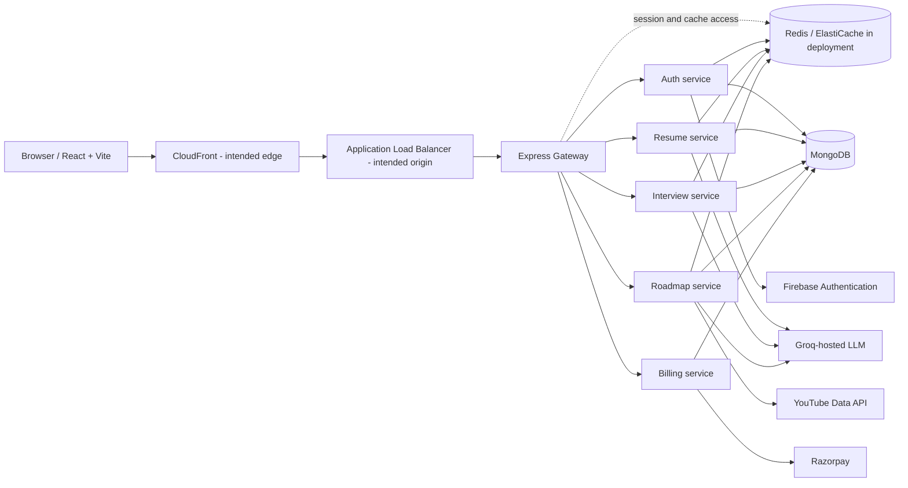
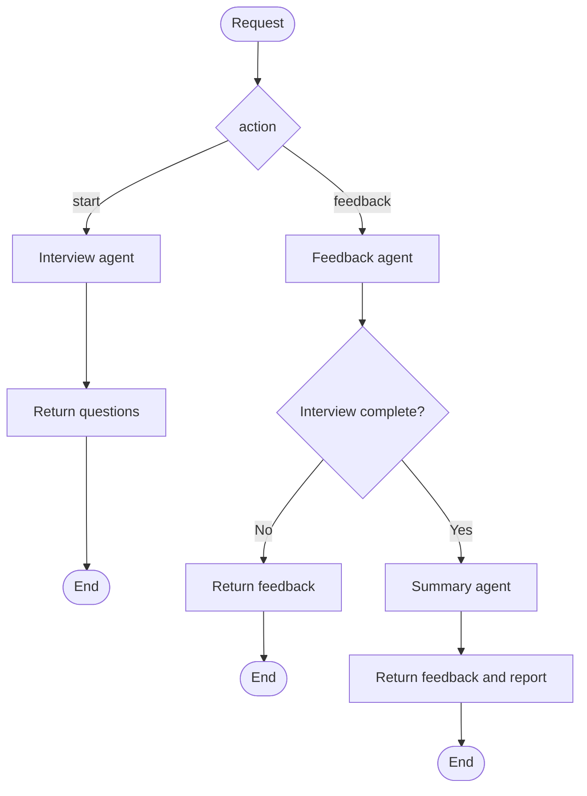

# InterviewAI

InterviewAI is a web application for AI-assisted interview practice, resume analysis, and personalized learning roadmaps. It consists of a React frontend, an Express gateway, and independently containerized Node.js backend services.

> **Architecture accuracy:** This README describes behavior visible in the repository and the AWS deployment model stated in the project brief. The repository does not include AWS infrastructure-as-code or exported AWS configuration, so deployed resource settings (such as subnet CIDRs, Availability Zones, listener rules, certificates, security-group rules, ECS task sizing, and autoscaling policies) cannot be verified here.

## Contents

- [Capabilities](#capabilities)
- [Architecture](#architecture)
- [Services and API routes](#services-and-api-routes)
- [AI workflows](#ai-workflows)
- [Redis and persistence](#redis-and-persistence)
- [AWS deployment model](#aws-deployment-model)
- [Run locally](#run-locally)
- [Configuration](#configuration)
- [Security, reliability, and operations](#security-reliability-and-operations)
- [Detailed technical documentation](docs/README.md)
- [Detailed AI agent architecture and diagrams](docs/ai-architecture/README.md)

## Capabilities

- Firebase ID-token login, Redis-backed sessions, and interview-credit operations.
- Resume PDF upload and AI-powered analysis.
- Interview question generation, answer feedback, and a final report.
- Role-based learning roadmaps with recommended video resources.
- Billing order creation and payment verification through Razorpay.
- A React single-page application built with Vite.

## Architecture

The gateway is the backend entry point. It routes requests by API prefix to the relevant service; the interview and roadmap workflows are orchestrated inside their own services. The diagram shows the deployment topology described in the project brief. The AWS-specific hops are intended architecture, not configurations checked into this repository.



The ALB and gateway have different responsibilities: the ALB is the proposed network entry point and forwards requests to the gateway; the gateway applies application-level prefix routing and forwards each request to a backend service. The gateway authenticates requests for resume, interview, roadmap, billing, and `/api/me`; `/api/auth` is proxied without the gateway's `isAuth` middleware.

## Services and API routes

The Dockerfiles declare the following container ports. These are image-level `EXPOSE` declarations; actual listener, target-group, or ECS port mappings are not defined in the repository.

| Component | Port | Responsibility |
|---|---:|---|
| Gateway | 8000 | CORS/cookie handling, session check, API routing, and forwarding the authenticated user ID to downstream services. |
| Auth | 8001 | Firebase token verification, user records, session login/logout, and interview credits. |
| Resume | 8002 | PDF upload/text extraction, AI analysis, and resume retrieval. |
| Interview | 8003 | Interview generation, answer feedback, reports, and interview history. |
| Roadmap | 8004 | Roadmap generation, resource lookup, and roadmap retrieval. |
| Billing | 8005 | Payment order creation and payment verification. |

Routes below are exposed through the gateway. The listed downstream paths are mounted at `/` in their respective services.

| Gateway route | Methods and downstream routes | Gateway session check |
|---|---|---|
| `/api/auth` | `POST /login`, `/logout`, `/use-coins`, `/add-coins` | No |
| `/api/resume` | `GET /`, `POST /` (multipart field `resume`) | Yes |
| `/api/interview` | `POST /start`, `POST /answer`, `GET /all`, `GET /:id` | Yes |
| `/api/roadmap` | `POST /generate`, `GET /all`, `GET /:id` | Yes |
| `/api/billing` | `POST /create`, `POST /verify` | Yes |
| `/api/me` | `GET /` (gateway handler) | Yes |

The gateway's `proxyWithHeaders` helper forwards `x-user-id` for authenticated service requests. Frontend API calls use `VITE_BACKEND_URL` and send browser credentials.

## AI workflows

The interview service uses a LangGraph state graph. A `start` action generates interview questions; a `feedback` action evaluates the submitted answer, and on completion the graph also generates a summary/report. Calls use `graph.invoke`, so the implementation is synchronous request/response; streaming is not configured in the inspected code.



The roadmap service has a separate, linear LangGraph workflow: its roadmap agent produces a plan, then its resource agent augments the plan with learning resources. Resume analysis uses a resume agent, but is not implemented as a LangGraph flow. Interview, roadmap, and resume agents call a Groq chat model through LangChain. Roadmap resource lookup also calls the YouTube Data API. These are external synchronous calls; background queues or asynchronous job coordination are not present in the repository.

## Redis and persistence

The shared Redis client uses `REDIS_URL`, with `redis://localhost:6379` as its local fallback. In deployment, point it at the intended Redis/ElastiCache endpoint and port; authentication and in-transit encryption are not established by the client code and must be confirmed in the deployed configuration.

| Use | Keys / behavior visible in code |
|---|---|
| Sessions | `session:<sessionId>` stores session data; login sets a seven-day Redis expiry. The browser cookie is HTTP-only, secure, `SameSite=None`, and has a seven-day max age. Logout deletes the session key. |
| Resume cache | `resume:<userId>` is read and written by the resume service. No explicit expiry is set at these call sites. |
| Roadmap cache | `userRoadmaps:<userId>` and `roadmap:<userId>:<roadmapId>` are cached for one hour. Generating a roadmap invalidates the user's roadmap-list key. |
| Interview history cache | `interview:<userId>` is read and invalidated by the interview service. |

MongoDB is used by the services for durable user, resume, interview, roadmap, and billing data. Redis is used for sessions, caches, and cache invalidation; it should not be treated as the durable system of record. The Redis client logs connection errors, but the inspected code does not provide a general cache-unavailable fallback.

## AWS deployment model

The project brief describes CloudFront, an Application Load Balancer, ECS, ECR, a VPC with separate ALB and ECS security groups, and ElastiCache for Redis OSS. The repository provides Dockerfiles for the gateway and each backend service, but does not include ECS task definitions, ECR configuration, a CloudFront distribution, ALB/listener/target-group configuration, VPC definitions, security-group rules, or CI/CD workflows.

The intended traffic path is:

1. The browser accesses the frontend; if deployed as described, CloudFront serves the frontend and/or forwards API requests to the ALB origin.
2. CloudFront-to-ALB and viewer-to-CloudFront protocols depend on the actual distribution and certificate settings. HTTPS on one connection does not prove HTTPS on the other.
3. The ALB forwards API traffic to the Gateway target group. No per-microservice ALB target groups are evidenced by the application code.
4. The Gateway proxies requests to the appropriate service using its configured service URL environment variables.
5. Services access MongoDB, Redis, or external integrations as needed.

For ECS deployment, each Dockerfile can be built and tagged as a separate image, pushed to its ECR repository, then referenced by a new ECS task-definition revision. Updating an ECR tag alone does not guarantee ECS replaces running tasks; a new task-definition revision or an explicit service deployment is normally required. Task execution roles, task roles, health checks, desired task counts, deployment settings, and autoscaling are deployment configuration and cannot be inferred from `EXPOSE` declarations.

### AWS verification checklist

| Area | Verify in the deployed account |
|---|---|
| VPC and routing | VPC/subnet layout, route tables, internet/NAT paths, and Availability Zone coverage. |
| Security groups | Public access should terminate at the ALB; ECS ingress should be restricted to the ALB security group where applicable; Redis should only accept traffic from authorized application security groups. |
| Load balancing | Listener protocols/certificates, listener rules, target group ports, health-check paths, and registered healthy ECS targets. |
| CloudFront | Origins, cache behaviors, viewer certificate, origin protocol policy, and whether API responses are cached or forwarded without caching. |
| ECS and ECR | Per-service task definitions, image tags/digests, IAM roles, logs, health checks, resource sizing, deployment and rollback policies. |
| ElastiCache | Network placement, Redis engine/version, authentication, TLS, backups/failover, monitoring, and capacity. |

## Run locally

Prerequisites: Node.js/npm and the external services/credentials required by the selected features.

1. Start the local Redis instance from the backend directory:

   ```powershell
   cd backend
   docker compose up -d redis
   ```

2. Run `npm install` separately from the frontend and each backend package directory (`backend`, `backend/gateway`, and each `backend/services/<service>` directory). For example:

   ```powershell
   cd frontend
   npm install
   ```

3. Configure the environment variables described below in the appropriate service environments.
4. Start the frontend with `npm run dev` from `frontend`; start the gateway with `npm start` from `backend/gateway`, and start each required service from its service directory using its Dockerfile command (`node index.js`, or `node src/index.js` for auth).

The included `backend/docker-compose.yml` starts Redis only; it does not start the application services, MongoDB, or the frontend. The frontend build and lint scripts are available as `npm run build` and `npm run lint`. Backend package test scripts are placeholders rather than test suites.

## Configuration

The source reads configuration from environment variables. Names include `VITE_BACKEND_URL` for the frontend; `PORT`, gateway `FRONTEND_URL` and per-service URL variables; `REDIS_URL`, `MONGODB_URL`; and integration settings for Firebase, Groq/LangChain, YouTube, and Razorpay. Supply values through a local, untracked environment file or a deployment secret manager. Do not commit credentials, private keys, tokens, or populated environment files. No root-level sample environment file is included.

## Security, reliability, and operations

- The gateway uses an allowlisted CORS origin from `FRONTEND_URL` and credentials-enabled requests. Production origin values should be explicit and narrowly scoped.
- Session cookies are HTTP-only and secure; Redis sessions expire after seven days. Ensure the edge, ALB, gateway, and browser cookie settings are consistent with the deployed HTTPS topology.
- The gateway forwards a user identifier in `x-user-id`. Keep backend services private and reachable only through trusted application networking; do not treat a caller-supplied header as authentication outside that boundary.
- Use least-privilege ECS task execution/task roles and a managed secrets mechanism. The repository alone cannot confirm deployed IAM policies or secret handling.
- Use immutable image tags or digests and deploy through reviewed task-definition revisions. Configure CloudWatch container logs, ECS/ALB/Redis metrics and alarms, and health checks in AWS; those settings are not included here.
- Redis connection failures are logged, and external-service/model calls can fail the corresponding request. Add and verify operational alarms, request correlation, and explicit dependency timeouts/retry behavior as deployment requirements.
- A multi-service design permits independent scaling in ECS, but actual desired counts, service autoscaling, multi-AZ placement, and Redis availability depend on AWS configuration not present in this repository.

For production readiness, prioritize validating private ECS and Redis networking, TLS across each required hop, secret storage, least-privilege IAM/security groups, health checks, service scaling, durable database backup/recovery, and monitoring/alerting. Avoid enabling shared caching for dynamic authenticated API responses at CloudFront unless cache keys and cache policies prevent cross-user data exposure.
