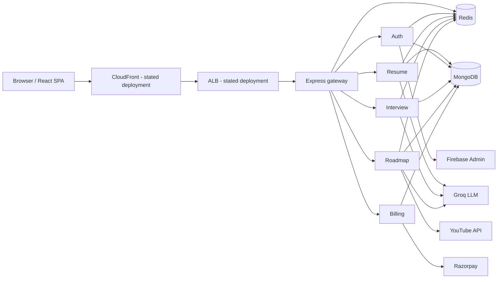

# 02 — System architecture

## Component relationships

The project brief describes CloudFront and an ALB before the application. In application code, the gateway is the first backend hop and performs prefix-based routing. ALB routing is distinct: the ALB should forward to the gateway, not make application decisions for every service.

See [diagrams/complete-system-architecture.mmd](diagrams/complete-system-architecture.mmd) for the standalone source.

## Request modes

The inspected handlers run database, Redis, LLM, and external API work inline before returning an HTTP response. The interview and roadmap graphs use `.invoke()`; no streaming transport, queue, or background worker is evident. Thus these are synchronous request/response flows from the API's perspective, even though each Node handler is asynchronous.

## Persistence

MongoDB stores application records. Redis holds sessions and selected service caches. Redis must not be interpreted as the permanent system of record. MongoDB hosting and backup configuration are not specified.

## Deployment confidence

Containers and their Dockerfiles are present. CloudFront, ALB, ECS, ECR, VPC and ElastiCache are part of the stated deployment model; detailed configuration is not in source control. The diagrams mark that boundary rather than inventing resource configuration.
