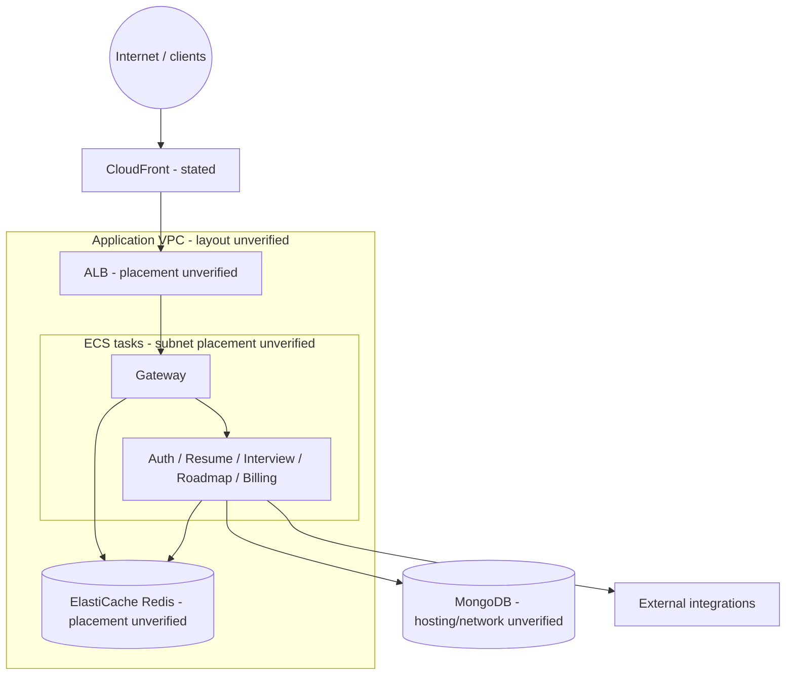

# 07 — VPC and networking

## Concepts applied to the stated design

A VPC is the account-level virtual network boundary. Subnets divide its address space and associate resources with a network location/AZ; route tables determine next hops for subnet traffic; security groups are stateful, resource-level allow/deny-by-default filters. These are complementary controls, not interchangeable.

In the stated design, the ALB receives application traffic and forwards it to gateway ECS targets. Gateway and backend services communicate over configured service URLs. Application services also reach Redis and MongoDB, and selected services make outbound calls to Firebase, Groq, YouTube, or Razorpay. The actual path (public/private subnets, NAT, VPC endpoints, peering, or external database) is not defined in the repository.

## Network topology (logical, not a deployed subnet map)

## Review checklist

Confirm ALB subnet/AZ coverage and routes, task subnet routes and egress, Redis subnet group and route reachability, DNS, NACLs if used, and the exact security-group references. Prefer task ingress only from the ALB security group for ALB-facing gateway traffic, and Redis ingress only from authorized application security groups. Never infer CIDRs, public/private status, NAT, or AZ count without deployed evidence.

The standalone diagram is [diagrams/vpc-networking.mmd](diagrams/vpc-networking.mmd).
