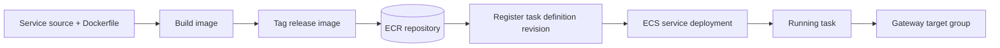

# 16 — Deployment architecture

## Build-to-runtime flow

Source → Docker build → per-service container image → ECR → ECS task-definition revision → ECS service deployment → running tasks → ALB Gateway target group.

Only the Dockerfiles and service code are in this repository. CI/CD configuration, ECR repositories, ECS task definitions/services, and deployment settings are absent. Do not infer a pipeline service.

## Rollout and rollback

Use a unique tag or digest, update the task definition, and deploy a new revision. ECS starts replacement tasks according to service deployment configuration; load balancer health determines whether gateway targets are considered healthy. Rollback can redeploy a known-good prior task-definition revision/image. Confirm actual deployment circuit breaker, minimum/maximum healthy percent, health-check grace period, and target group health settings in the account.

## Images

Separate images allow service-specific releases and scaling. The Dockerfiles currently use `FROM node` and `npm install`; image hardening and deterministic dependency install are not established. See [14-docker-and-ecr.md](14-docker-and-ecr.md).
