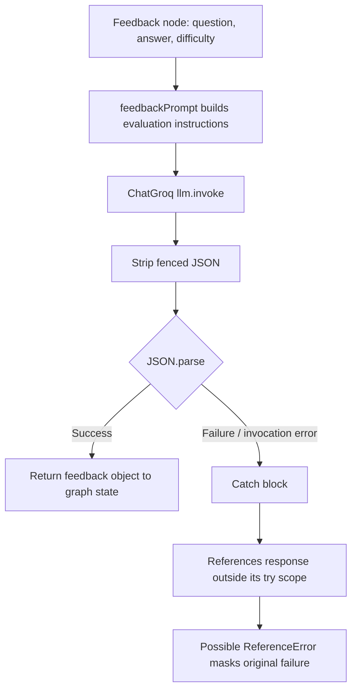

# Answer feedback agent

## Overview

`feedbackAgent` evaluates one answer against one interview question. The interview graph's `feedbackAgent` node calls it; the agent does not directly advance the interview or call the summary agent.

**Source:** `backend/services/interview/agents/feedback.agent.js`, prompt `backend/services/interview/prompts/feeedbackPrompt.js`, model `backend/services/interview/config/llm.js`.

## Input and output

Input: `{ question, answer, difficulty }` from the current stored interview question and submitted answer.

The prompt asks for JSON with `score`, `correctness`, `clarity`, `relevance`, `detail`, `efficiency`, `communication`, `problemSolving`, `creativity`, `feedback`, and exactly three short `improvements`. Score fields are prompted to be 0–100; there is no runtime schema/range validation. The graph node returns `{ feedback }`.

Illustrative input:

```json
{"question":"Explain the event loop.","answer":"It coordinates queued work around the call stack.","difficulty":"easy"}
```

Output is model-generated JSON matching the prompt contract, e.g. score fields plus feedback/improvements. Values are not deterministic.

## Execution and failure behavior

The agent builds a prompt with `feedbackPrompt(data)`, awaits `llm.invoke(prompt)`, removes Markdown JSON fences, parses JSON, then returns the object. It does not retrieve conversation history or call tools.

The catch block currently references `response.content`, but `response` is declared inside the `try` block. On an error this can raise a `ReferenceError`, masking the original exception; the agent does not reliably rethrow the original error. The graph/controller then cannot guarantee a well-shaped feedback response. Documented as-is; source is unchanged.


