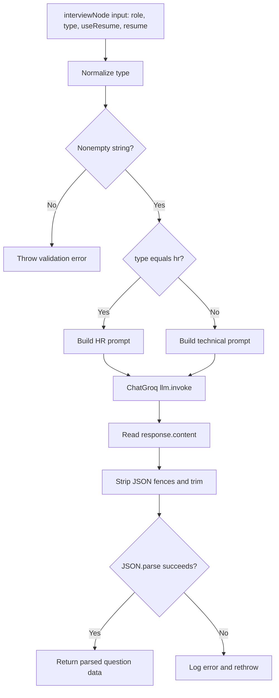

# Interview question agent

## Overview

`interviewAgent` generates the question list for a new interview. It is invoked by the `interviewAgent` node in the interview LangGraph, itself called by `startInterview` after the API validates `type` and `role`.

**Source:** `backend/services/interview/agents/interview.agent.js`; prompts in `backend/services/interview/prompts/hrInterviewPrompt.js` and `technicalInterviewPrompt.js`; model in `backend/services/interview/config/llm.js`.

## Input and output

The node passes `{ role, type, useResume, resume }`.

| Field | Role |
|---|---|
| `type` | Required nonempty string at agent boundary; trimmed/lowercased. Exact `"hr"` chooses HR prompt; other nonempty values choose technical prompt. The API model restricts type to `hr`/`technical`. |
| `role` | Candidate's target role, interpolated into prompt |
| `useResume` | Chooses whether resume context is included by prompt template |
| `resume` | Optional resume context when enabled |

The technical prompt requests exactly six objects containing `question`, `difficulty`, and `timer`; difficulty levels are ordered `easy, easy, medium, hard, medium, hard`. This is a prompt requirement, not runtime schema validation. The HR prompt has its own instructions. The agent strips Markdown JSON fences and calls `JSON.parse`; it does not validate parsed shape.

Example input (illustrative):

```json
{"role":"Backend Developer","type":"technical","useResume":false,"resume":{}}
```

The result is the parsed model response, expected by the controller to be an array of question objects. Exact generated text is nondeterministic.

## Execution and failures

1. Normalize and validate `type`; empty/missing values throw.
2. Select HR prompt only for normalized `hr`; otherwise select technical prompt.
3. Invoke `llm.invoke(prompt)`.
4. Strip fenced JSON markers, trim, and parse.
5. Return parsed JSON to the graph node, which writes it to `questions`.

The `try/catch` logs and rethrows. There is no agent-specific fallback or output-schema validator. ChatGroq is configured for model `openai/gpt-oss-120b`, temperature `0.2`, `maxRetries: 2`. The agent does not access Redis, MongoDB, or external tools.


