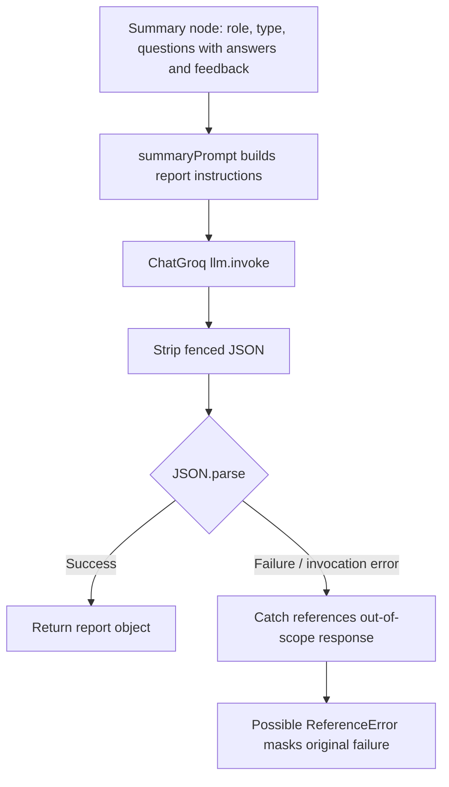

# Interview summary agent

## Overview

`summaryAgent` creates the final report after feedback for the last question. The graph node calls it only when the interview graph's completion router sees `completed === true`.

**Source:** `backend/services/interview/agents/summary.agent.js`, prompt `backend/services/interview/prompts/summaryPrompt.js`, model `backend/services/interview/config/llm.js`.

## Input and output

Input: `{ role, type, questions }`. `questions` is the interview's question array passed by the controller before it stores the just-generated feedback from the current answer. On the final answer, the current answer is set before graph invocation, but that answer's newly generated feedback is only assigned after graph execution; therefore the summary prompt does not yet include the final answer's feedback. Earlier questions' feedback is present.

Prompt output contract: `overallScore` (0–100), `summary` (80–120 words), 3–5 `strengths`, 3–5 `weaknesses`, and five `recommendations`. The agent parses JSON but performs no schema, length, or numeric validation. The node returns `{ report }`.

Example input shape:

```json
{"role":"Backend Developer","type":"technical","questions":[{"question":"Explain the event loop.","userAnswer":"...","feedback":{"score":72,"feedback":"...","improvements":["..."]}}]}
```

## Execution and failures

The function constructs `summaryPrompt(data)`, calls `llm.invoke`, strips JSON fences, parses and returns the report. No database or Redis calls occur in the agent itself; the interview controller persists report fields to the interview document.

Like `feedbackAgent`, its catch block refers to `response.content` even though `response` is scoped inside `try`, which may mask an invocation/parse failure with a `ReferenceError`.


