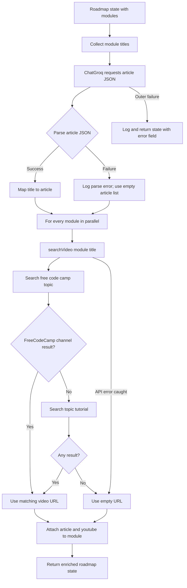

# Learning resource agent

## Overview

`resourceAgent` enriches roadmap modules with article/documentation strings and YouTube URLs. It is the second and final node in the roadmap graph. It combines an LLM call with a conventional API helper; it does not let the model execute arbitrary tools.

**Source:** `backend/services/roadmap/agents/resource.agent.js`; YouTube helper `backend/services/roadmap/configs/youtube.js`; model `backend/services/roadmap/configs/llm.js`.

## Input and output

Input is roadmap graph state; it reads `state.roadmap.modules`, especially each module's `title`. It requests an array of `{title, article}` from the LLM, maps article values by lowercase title, then mutates each roadmap module with `youtube` and `articles` using `Promise.all`.

`searchVideo(topic)` searches YouTube Data API for `free code camp <topic>` and returns the first result only if channel title includes `freecodecamp.org`; otherwise it makes a fallback `<topic> tutorial` search and returns its first result. It returns `null` on API errors/no result. Each module receives `youtube: ""` when no video is returned and `articles: ""` when no title match exists.

## Failure behavior

Malformed LLM article JSON is logged and converted to an empty list; module enrichment continues. YouTube helper errors are logged and converted to `null`. A broader resource-agent error is caught, logged, and returned as `{ ...state, error }` rather than thrown. Since that return can look state-shaped, the controller may continue; this is a partial-success behavior, not an explicit graph failure signal.

On the successful path the function returns `{ state, ...roadmap }` (the roadmap object's properties are spread at the top level), not an explicit `{ roadmap: enrichedRoadmap }` state update. The implementation mutates the original `state.roadmap` object before returning. Because the graph declares a `roadmap` state key, the actual final output/enrichment persistence depends on object mutation and LangGraph state merge semantics; this shape should be treated as an implementation caveat, not assumed to be a clean state update.

