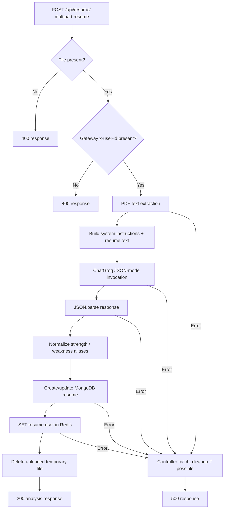

# Resume analysis agent

## Overview

`resumeAgent` extracts structured candidate information and recommendations from PDF text. The resume controller calls it directly; it is not part of a LangGraph.

**Source:** `backend/services/resume/agents/resume.agent.js`; PDF extraction `backend/services/resume/config/pdf.js`; model `backend/services/resume/config/llm.js`.

## Input and output

Input is one string: extracted resume text. The controller obtains it from `extractText(file.path)`, which synchronously reads the uploaded file and calls `PDFParse.getText()`.

The system prompt requests JSON fields: `name`, `email`, `phone`, `summary`, `skills[]`, `projects[]`, `education[]`, `experience[]`, `strength[]`, `weakness[]`, `missingSkills[]`, `suggestedRole`, `score`, and `recommendations[]`. It configures `response_format: { type: "json_object" }`, parses response content, and normalizes `strength`/`weakness` from plural aliases if necessary. There is no schema/range validation after parsing.

Example invocation input is extracted plain text, not an uploaded file object. Output is the parsed analysis object.

## Persistence and failures

The agent itself makes only the model call. `uploadResume` verifies a file and `x-user-id`, extracts text, invokes the agent, creates/updates the user's MongoDB document with extracted text and analysis, sets `resume:<userId>` in Redis, removes the temporary upload, and responds. Controller errors return HTTP 500 and attempt upload cleanup. The agent has no explicit catch/fallback; parsing and model errors propagate to the controller.

