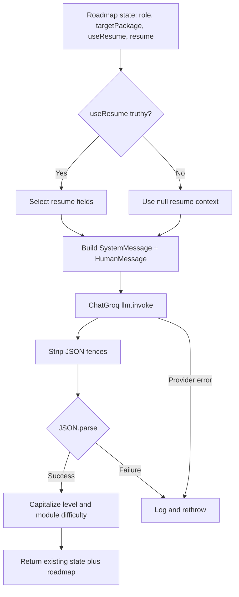

# Roadmap generation agent

## Overview

`roadmapAgent` creates a learning roadmap for a target role and package. It is the first node in the roadmap LangGraph.

**Source:** `backend/services/roadmap/agents/roadmap.agent.js`; prompt `backend/services/roadmap/prompts/prompt.js`; model `backend/services/roadmap/configs/llm.js`.

## Input and output

Graph state fields read: `role`, `targetPackage`, `useResume`, `resume`. If `useResume` is truthy, the function selects skills, missing skills, projects, experience, score, a suggested-role property, and recommendations for prompt context. The source reads `state.resume.suggesstedRole` (misspelled); the resume model defines `suggestedRole`, so that field is likely omitted from the constructed context.

The prompt asks for 8–15 modules with title, target package, duration, level, and module title/duration/difficulty/description. JSON is parsed; `level` and module difficulty are capitalized; result merges existing `state` and `roadmap`. Runtime schema validation is not performed.

Illustrative graph input:

```json
{"role":"Backend Developer","targetPackage":"target package","useResume":false,"resume":null}
```

## Execution and failure behavior

Build optional resume subset → call ChatGroq using system and human messages → strip JSON fences → parse → normalize level/difficulty → return merged state. The function logs and rethrows errors. No database or Redis access occurs in this agent; the controller persists the completed roadmap after the graph returns.


