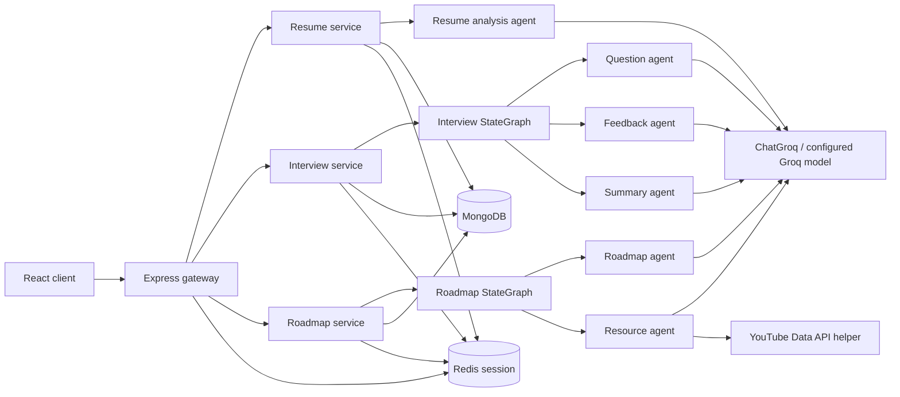

# AI system overview

## Runtime architecture

The React frontend calls the Express gateway through `VITE_BACKEND_URL`. The gateway checks Redis-backed sessions on protected interview, resume, and roadmap routes, then forwards `x-user-id` to the corresponding backend service. Each service runs its workflow synchronously and returns an HTTP response. The workflows make direct LangChain model calls; only interview and roadmap use LangGraph.

## Inventory

| Workflow | Agent functions | Orchestration | Persistence |
|---|---|---|---|
| Resume analysis | `resumeAgent` | Direct call; no LangGraph | Resume document in MongoDB; cache in Redis |
| Interview | `interviewAgent`, `feedbackAgent`, `summaryAgent` | `StateGraph` with conditional start and completion routing | Interview record and progress in MongoDB; Redis list cache is invalidated on completion |
| Roadmap | `roadmapAgent`, `resourceAgent` | Linear `StateGraph` | Roadmap in MongoDB; Redis list/detail caches |

## LLM and prompts

The services initialize separate `ChatGroq` clients:

- Interview: `backend/services/interview/config/llm.js`, model `openai/gpt-oss-120b`, temperature `0.2`, `maxRetries: 2`.
- Roadmap: `backend/services/roadmap/configs/llm.js`, same model/temperature, `maxTokens: 4000`, `maxRetries: 2`.
- Resume: `backend/services/resume/config/llm.js`, same model/temperature, `maxTokens: 2500`, `maxRetries: 2`.

The retry value is model-client configuration; it is not an application-level retry workflow. Prompts are string templates or `SystemMessage`/`HumanMessage` pairs. Most agents parse JSON from text; the resume agent also requests JSON response mode.

## Important limits of the implementation

- No graph checkpoint saver, durable graph state, thread ID, or conversation-message history is configured.
- Interview continuity is application persistence: questions/answers are saved in MongoDB, and each answer request constructs a new graph input.
- Graph calls and external LLM/API calls run inline; there is no queue, background worker, or streaming API.
- No standalone tool-calling mechanism is implemented. YouTube search is a deterministic Axios helper called by the resource agent.
- A “multi-agent” label should not imply peer-to-peer agent conversations; nodes pass graph state sequentially.

See the [agent inventory](agents/README.md), [graph architecture](langgraph/README.md), and [workflow traces](workflows/).
